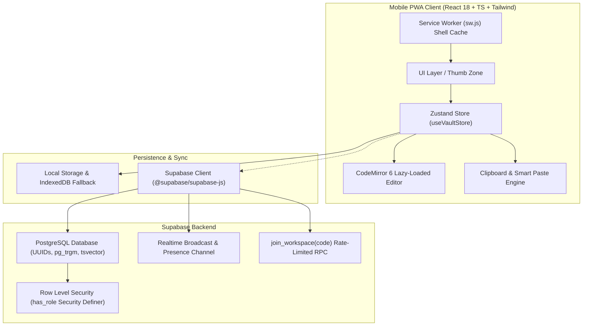

# LabVault ⚡

> **Mobile-First Collaborative Code Repository for Lab Assignments & Course Solutions**  
> Designed with **frictionless snippet copy/paste on a phone** as the #1 design priority.

---

## 📱 Product Highlights & Core Principles

1. **1-Tap Snippet Copy/Paste**:
   - Single tap copies any function or full program directly to the clipboard.
   - Dual-engine clipboard: modern `navigator.clipboard.writeText` with resilient hidden-textarea `execCommand('copy')` fallback for iOS Safari and non-secure environments.
   - Instant visual checkmark morph (1.2s), non-intrusive floating toast above the bottom thumb zone, and haptic feedback (`navigator.vibrate(10)`).
   - Swipe right on any tree row to copy a question's full solution directly from the tree in 1 swipe!

2. **Smart Paste Function Splitting**:
   - Paste a source file containing multiple functions (e.g. `isFull()`, `isEmpty()`, `insertElement()`).
   - LabVault’s regex-based AST analyzer detects function boundaries, language signatures (Java vs C++), and offers to split the pasted code into distinct labelled blocks in one tap.

3. **Bottom Thumb Zone Optimization**:
   - All primary actions sit within comfortable one-handed reach on 360px+ screens.
   - Touch targets strictly meet or exceed **48×48px**.
   - Sticky bottom thumb bar hosts `[Copy All] [＋ Block] [Java | C++]`.

4. **Infinite Dynamic Outline Tree**:
   - Nested lab assignments up to 10+ levels deep (`Courses › DS Lab › Unit 1 › Experiment 1 › 1.1.2 Array Stack`).
   - Automatic outline numbering (`1`, `1.1`, `1.1.2`) computed dynamically from sibling order via **fractional indexing** (`fractional-indexing`).
   - Rolled-up progress ring on every folder calculated from descendant completed questions.

5. **Safe Read Mode by Default**:
   - Read-only CodeMirror 6 viewer prevents mobile keyboards from accidentally popping up when browsing code.
   - Dedicated full-screen Edit mode with soft keyboard symbol toolbar: `Tab  {  }  (  )  [  ]  ;  <  >  #  &  *  :  "  '  ->  Undo  Redo`.

6. **Real-Time Collaboration & Presence**:
   - Supabase Realtime Broadcast & Presence with Yjs (`y-codemirror.next`) for live typing and remote cursor labels.
   - Header avatar stack and glowing active-editor indicators on blocks.
   - 30-day soft-delete trash recovery and block version snapshot diffs with 1-tap restore.

---

## 🏗️ Architecture Diagram



---

## 🔐 Role Matrix & Access Control

| Feature / Action | Admin | Contributor | Viewer |
| :--- | :---: | :---: | :---: |
| **View code & outline tree** | ✅ | ✅ | ✅ |
| **1-Tap Copy & Copy All** | ✅ | ✅ | ✅ |
| **Offline Reading** | ✅ | ✅ | ✅ |
| **Edit code blocks & variants** | ✅ | ✅ | ❌ *(Hidden in UI & blocked by RLS)* |
| **Add / Reorder blocks** | ✅ | ✅ | ❌ |
| **Add / Move folders & questions**| ✅ | ✅ | ❌ |
| **Smart Paste & function split** | ✅ | ✅ | ❌ |
| **Manage workspace members** | ✅ | ❌ | ❌ |
| **Generate join codes & links** | ✅ | ❌ | ❌ |
| **Permanent deletion / Trash purge**| ✅ | ❌ | ❌ |

---

## 🗄️ Database Schema & SQL Deliverables

The database migrations are located in `supabase/migrations/`:
- `001_initial_schema.sql`: Full schema with enums (`member_role`, `node_type`, `question_status`, `code_lang`), tables (`profiles`, `workspaces`, `workspace_members`, `join_requests`, `nodes`, `question_blocks`, `block_variants`, `block_versions`, `block_comments`, `copy_templates`, `share_links`, `activity_log`), and GIN trigram / tsvector indexes.
- `002_rls_and_policies.sql`: Row Level Security policies on every table with the `has_role(ws uuid, min member_role)` security definer helper function.
- `003_triggers_and_rpcs.sql`: Automated `updated_at` triggers, new user hook, and rate-limited `join_workspace(code)` RPC (maximum 5 attempts per minute per user).
- `supabase/seed.sql`: Rich demo data featuring the **DS Lab** workspace, Unit 1, Experiment 1, Question 1.1.2 "Array Stack", with 3 functions (`isFull`, `isEmpty`, `insertElement`) in both Java and C++, templates, and comments.
- `supabase/tests/rls_tests.sql`: Automated SQL test suite verifying that Viewers cannot update or insert, outsiders cannot read, and contributors cannot delete.

---

## 🚀 Getting Started

### Prerequisites
- Node.js 18+ (tested on Node v22.16.0)
- npm 9+

### 1. Clone & Install
```bash
npm install
```

### 2. Environment Configuration (Optional for Supabase)
LabVault includes an instant out-of-the-box local storage & offline mock engine with the complete seeded DS Lab dataset. To connect to your live Supabase cloud project:

```bash
cp .env.example .env.local
```

Edit `.env.local`:
```ini
VITE_SUPABASE_URL=https://your-project.supabase.co
VITE_SUPABASE_ANON_KEY=eyJhbGciOiJIUzI1NiIsInR5cCI6IkpXVCJ9...
```

### 3. Run Development Server
```bash
npm run dev
```
Open your browser at `http://localhost:5173`. Open Chrome DevTools and switch to Mobile Device Mode (e.g. iPhone 14 or Pixel 7) to experience the mobile-first UX.

### 4. Build for Production
```bash
npm run build
npm run preview
```

---

## 🧪 Testing Acceptance Criteria

1. **1-Tap Snippet Copy**:
   - Open Question 1.1.2 "Array Stack".
   - Tap **Copy** on `int isFull()`: button morphs to `Copied ✓` for 1.2s, haptic vibrates, and a toast reads *"Snippet copied (8 lines)"*.
   - Tap **Copy All**: full combined code copies with boilerplate.
   - In the tree drawer, swipe right on any Question row to copy all code in 1 swipe!

2. **Smart Paste Function Splitting**:
   - Tap **Paste** on the question page or block card.
   - Paste a block of text containing 2 or more Java or C++ functions.
   - LabVault automatically detects the signatures and provides a 1-tap button to *"Split into N Blocks"*.

3. **Outline Numbering & Infinite Hierarchy**:
   - Notice Unit 1 has outline `1`, Experiment 1 has `1.1`, and Array Stack has `1.1.2`.
   - Tap **Generate Series** to bulk create 5 or 10 experiments in one click.

4. **Role Enforcement**:
   - Tap **Members** in the sidebar.
   - Switch role to **Viewer**: notice that all Edit, Paste, Add Block, and Delete controls immediately vanish from the interface! Switch back to **Admin** to restore full management controls.

5. **Trash & History Diff**:
   - Delete a block or question; an undo toast appears immediately.
   - Open **Trash** to restore any soft-deleted item.
   - Open **History** on any block to preview snapshots and tap **Restore Snapshot**.
